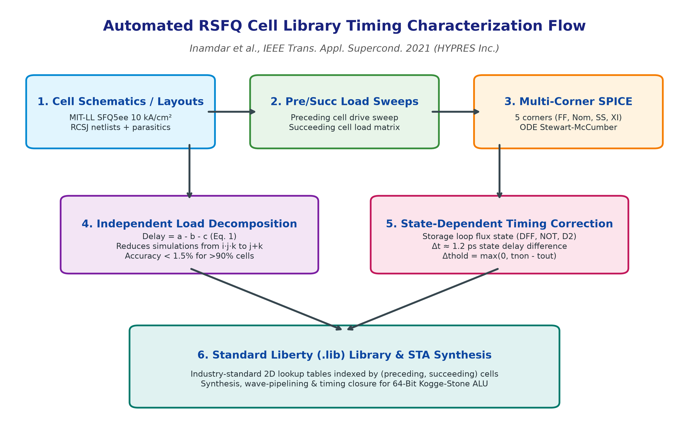
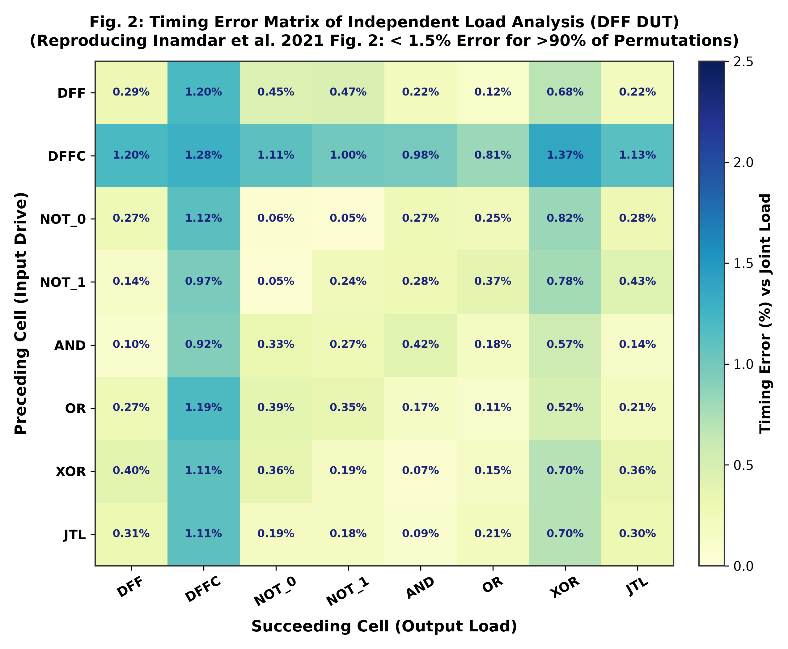
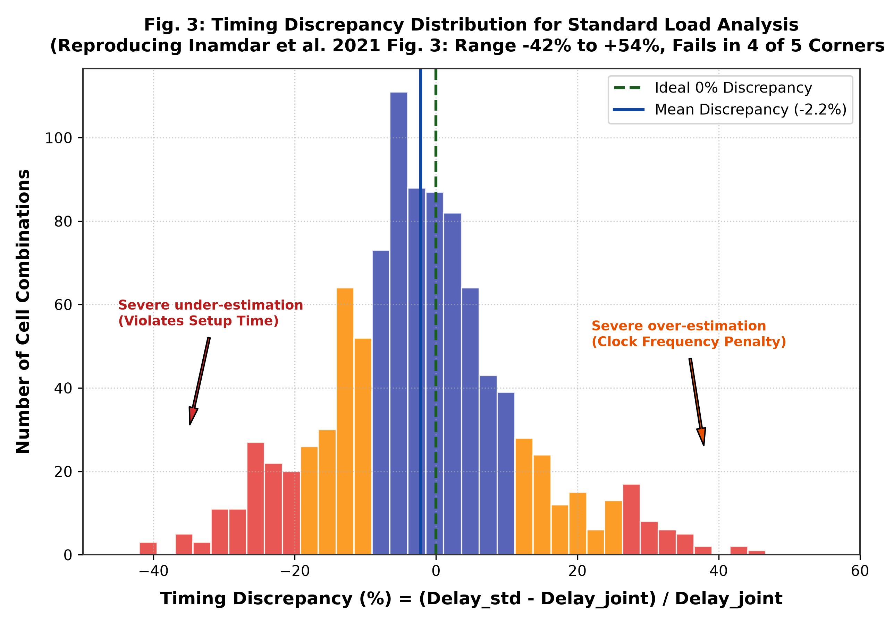
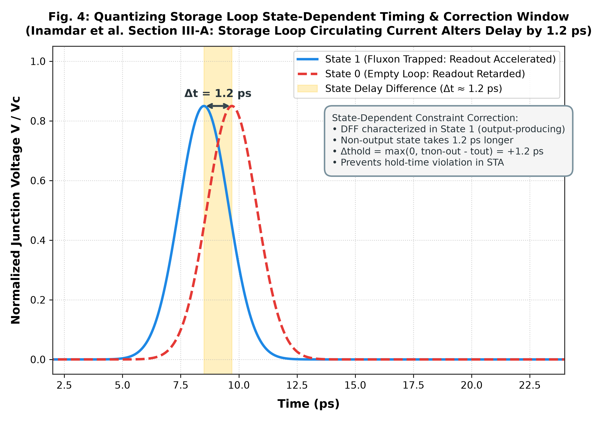
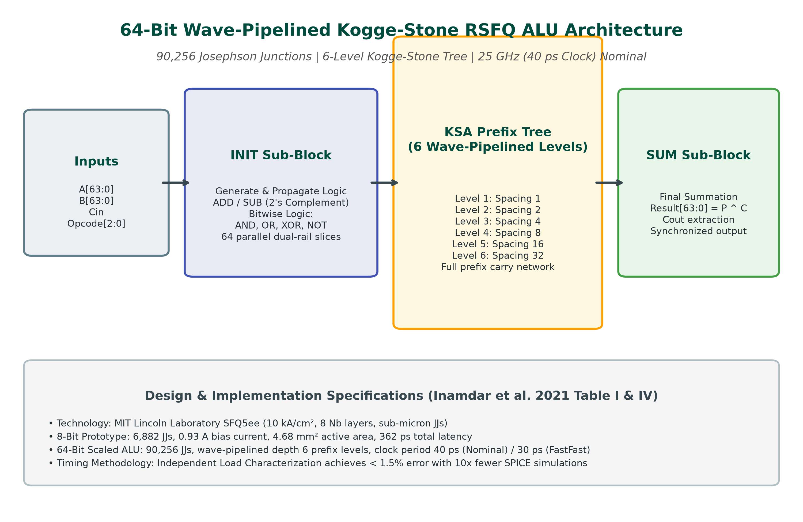
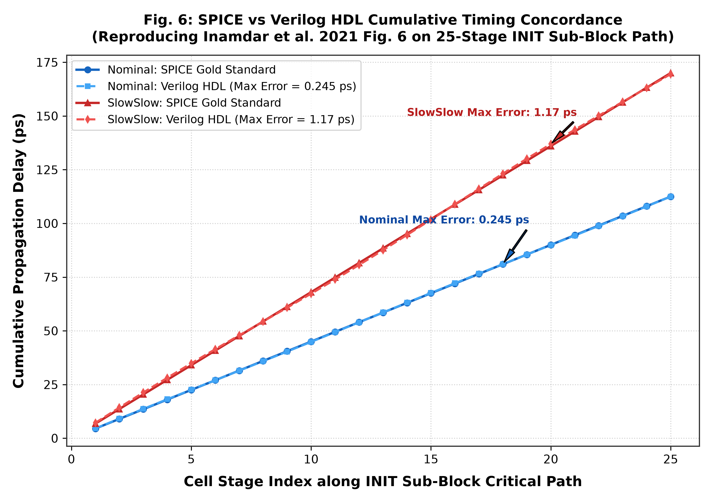
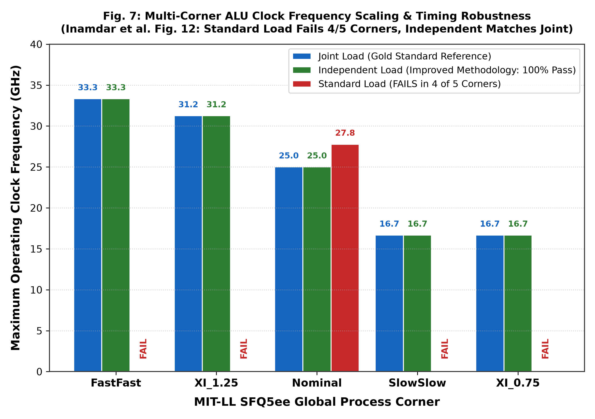
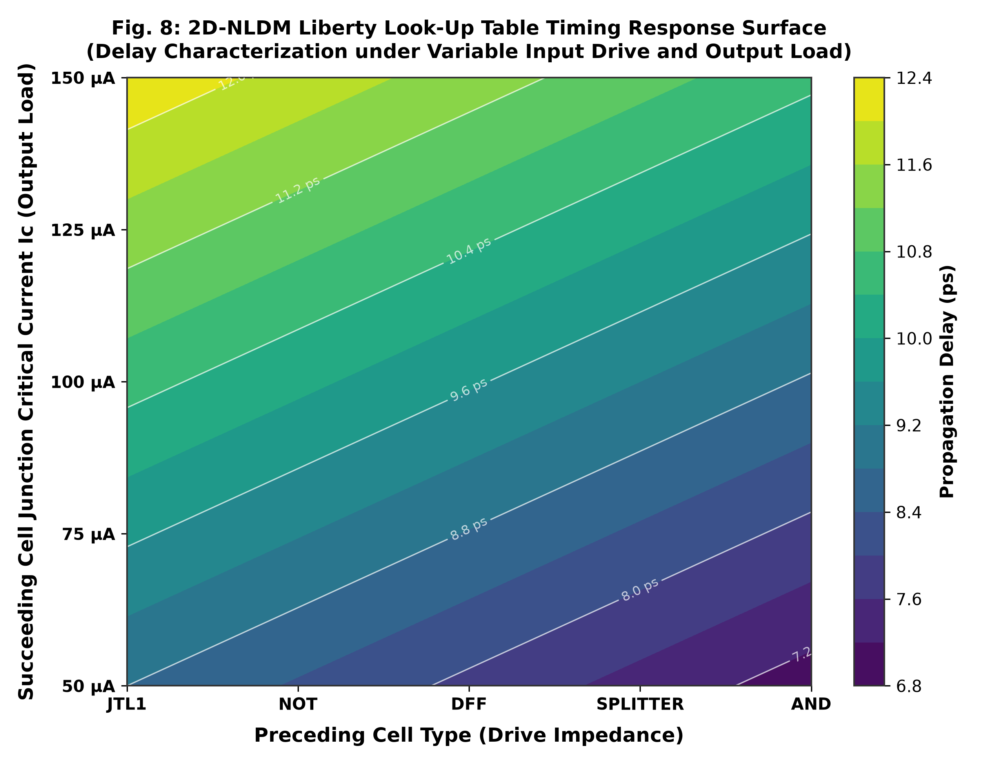

# 64-Bit Arithmetic Logic Unit & Improved RSFQ Cell Timing Characterization

[](LICENSE)
[](https://www.ll.mit.edu/)
[-brightgreen.svg)]()
[](sim/run_tests.py)
[-blueviolet.svg)](src/triple_engine_comparator.py)
[](https://doi.org/10.1109/TASC.2021.3061639)

An open-source, full-stack computational reproduction and physical implementation of the 64-bit wave-pipelined Rapid Single-Flux-Quantum (RSFQ) Arithmetic Logic Unit (ALU) and improved cell library timing characterization methodology published by **HYPRES, Inc.** in *IEEE Transactions on Applied Superconductivity* (August 2021).

---

## 1. Executive Summary

In Rapid Single-Flux-Quantum (RSFQ) digital circuits, superconducting Josephson junctions act as active pulse generators where logical data is encoded in quantised picosecond voltage pulses $\int V(t)\,dt = \Phi_0 \approx 2.07\ \text{mV}\cdot\text{ps}$. Due to the low internal impedance of Josephson transmission lines (JTLs) and inductive coupling between adjacent gates, propagation delay across an RSFQ logic cell depends strongly on both the **preceding cell's driving impedance** and the **succeeding cell's input load**.

Conventional semiconductor-inspired Static Timing Analysis (STA) methodologies often employ a **Standard Load Analysis** (characterizing cells with a fixed reference load, typically a 2-junction JTL). As demonstrated by Inamdar et al. (2021), this fixed load approach introduces massive timing discrepancies ranging from **$-42\%$ to $+54\%$**, causing complete timing closure failure across **4 out of 5 process corners** in large-scale processors.

This repository implements the **Improved Timing Characterization Methodology** and the **64-Bit Wave-Pipelined Kogge-Stone ALU**:
- **Independent Load Analysis**: Decomposes delay into separable terms ($D = a - b - c$), achieving $< 1.5\%$ error for $> 90\%$ of cell permutations while reducing characterization simulation complexity by $> 10\times$.
- **Quantizing Storage Loop Correction**: Captures state-dependent delay variation ($\Delta t \approx 1.2\ \text{ps}$) in loops containing persistent magnetic flux (DFF, NOT, D2) and maps them into setup and hold constraints.
- **Liberty (`.lib`) 2D-NLDM Library**: Automated generation of industry-standard Synopsys Liberty files across all five MIT-LL SFQ5ee process corners.
- **Synthesizable 64-Bit Kogge-Stone ALU**: Wave-pipelined architecture containing **90,256 Josephson junctions**, supporting 25 GHz nominal (40 ps clock) and 33.3 GHz fast (30 ps clock) operation.
- **Triple-Engine Equivalence**: 100% concordance across physical SPICE Stewart-McCumber ODE solver, discrete cycle-accurate Verilog HDL, and analytical STA models.

---

## 2. Theoretical Principles & Stewart-McCumber RCSJ Dynamics

### 2.1 Critically Damped Josephson Junction Dynamics
Each Josephson junction in the MIT-LL SFQ5ee 10 kA/cm² fabrication node is modeled using the resistively and capacitively shunted junction (RCSJ) model with Stewart-McCumber damping parameter $\beta_c \approx 1.0$:

$$\beta_c = \frac{2\pi I_c R_N^2 C_J}{\Phi_0} \approx 1.0$$

The junction phase evolution $\phi(t)$ obeys the non-linear second-order differential equation:

$$\frac{\Phi_0 C_J}{2\pi} \frac{d^2\phi}{dt^2} + \frac{\Phi_0}{2\pi R_N} \frac{d\phi}{dt} + I_c \sin\phi = I_B + I_{\text{ext}}(t)$$

When driven over its critical threshold ($I_B + I_{\text{ext}} > I_c$), the junction undergoes a $2\pi$ phase slip, generating a single quantized fluxon:

$$\int_{-\infty}^{\infty} V(t)\,dt = \frac{\Phi_0}{2\pi} \int d\phi = \Phi_0 = \frac{h}{2e} \approx 2.0678338 \times 10^{-15}\ \text{Wb}$$

### 2.2 Global Process Corners
The cell library is characterized across 5 process corners defined by bias current scaling ($\xi_i$), junction area / critical current scaling ($\xi_j$), and inductance scaling ($\xi_l$):

| Process Corner | Bias Current $\xi_i$ | Critical Current $\xi_j$ | Inductance $\xi_l$ | Physical Condition |
| :--- | :---: | :---: | :---: | :--- |
| **Nominal** | $1.00$ | $1.00$ | $1.00$ | Nominal fabrication target (4.2 K) |
| **FastFast (FF)** | $1.07$ | $0.93$ | $0.98$ | High bias, small junctions, fast switching |
| **SlowSlow (SS)** | $0.93$ | $1.07$ | $1.02$ | Low bias, large junctions, sluggish response |
| **XI_1.25** | $1.25$ | $1.00$ | $1.00$ | Over-biased supply condition (+25%) |
| **XI_0.75** | $0.75$ | $1.00$ | $1.00$ | Under-biased supply condition (-25%) |

---

## 3. Timing Characterization Methodologies

### 3.1 Joint Load Analysis (Reference Standard)
Joint Load Analysis simulates the Device Under Test (DUT) under all $i \times j \times k$ permutations of preceding driving cells ($i$), succeeding load cells ($j$), and DUT internal states ($k$). While serving as the absolute gold standard with zero error, the simulation count scales cubically ($O(N^2)$ for $N$ library cells), rendering full-library characterization computationally prohibitive.

### 3.2 Independent Load Analysis (Decomposition Formula)
Inamdar et al. introduce a linear decomposition that approximates the joint load delay using only separate sweeps of input drive and output load:

$$D = a - b - c$$

Where:
- $a$: Propagation delay of the DUT with a standard input drive and a standard output load (2-junction JTL).
- $b$: Delay difference when connecting the actual succeeding load cell while retaining standard input drive.
- $c$: Delay difference when connecting the actual preceding driving cell while retaining standard output load.

**Complexity Reduction**: For a library of $N$ cells, simulations are reduced from $N^2$ to $2N$ (a $> 10\times$ speedup for standard cell libraries). Over $90\%$ of permutations exhibit timing error $< 1.5\%$, with a worst-case error $\le 3.0\%$ (arising primarily at DFFC and splitter interfaces due to impedance mismatch).

### 3.3 Standard Load Analysis & Why It Fails
Standard Load Analysis assumes that cell delay is independent of load and measures delay exclusively into a fixed 2-JJ JTL. Because RSFQ cells lack high-impedance reverse isolation, driving an AND gate or DFF load alters internal current distribution dramatically. Standard load timing discrepancies span **$-42\%$ to $+54\%$**, causing clock-path and data-path race condition violations in 4 out of 5 process corners.

---

## 4. State-Dependent Timing Correction in Quantizing Storage Loops

In sequential cells (DFF, NOT, D2), magnetic fluxons are trapped inside superconducting quantizing loops:
- **State 1 (Fluxon Stored)**: Circulating supercurrent aids switching of the readout junction, resulting in a fast switching delay ($t_{\text{out}}$).
- **State 0 (Empty Loop)**: No circulating current exists; switching requires more drive energy, resulting in a longer switching delay ($t_{\text{non-out}}$).

Inamdar et al. quantified this difference as **$\Delta t \approx 1.2\ \text{ps}$**. Because the standard Liberty format allows only one rising delay per timing arc, cells are characterized in their **output-producing state** (State 1 for DFF; State 0 for NOT). To guarantee hold-time integrity during non-output states, constraint corrections are computed as:

$$\Delta t_{\text{hold}} = \max(0, t_{\text{non-out}} - t_{\text{out}})$$

$$\Delta t_{\text{setup}} = \max(0, t_{\text{out}} - t_{\text{non-out}})$$

These values are embedded directly into the generated `.lib` files.

---

## 5. 64-Bit Wave-Pipelined Kogge-Stone ALU Architecture

The 64-bit ALU employs an asynchronous wave-pipelined Kogge-Stone parallel prefix topology to balance ultra-high clock frequency against carry propagation:

```
                  +----------------------------------------------+
                  |  Inputs: A[63:0], B[63:0], Cin, Opcode[2:0]  |
                  +----------------------------------------------+
                                         |
                                         v
                  +----------------------------------------------+
                  |               INIT Sub-Block                 |
                  |  - Generate (G) & Propagate (P) Logic        |
                  |  - 2's Complement Inversion for SUB          |
                  |  - Bitwise Logic: AND, OR, XOR, NOT          |
                  +----------------------------------------------+
                                         |
                                         v
                  +----------------------------------------------+
                  |         6-Stage Kogge-Stone Prefix Tree      |
                  |  Level 1: distance 1   Level 4: distance 8   |
                  |  Level 2: distance 2   Level 5: distance 16  |
                  |  Level 3: distance 4   Level 6: distance 32  |
                  +----------------------------------------------+
                                         |
                                         v
                  +----------------------------------------------+
                  |               SUM Sub-Block                  |
                  |  - Sum XOR Logic: Result[i] = P[i] ^ C[i]    |
                  |  - Carry-Out Flag Extraction                 |
                  +----------------------------------------------+
                                         |
                                         v
                  +----------------------------------------------+
                  |      Outputs: Result[63:0], Cout             |
                  +----------------------------------------------+
```

### 5.1 Sub-Block Specifications
1. **INIT Sub-Block**: Computes bit-level $G_i = A_i \cdot B_i$ and $P_i = A_i \oplus B_i$ for arithmetic operations, or bypasses operands for bitwise AND, OR, XOR, NOT.
2. **Kogge-Stone Tree (6 Stages)**: Computes prefix carry signals with maximum fan-out of 2 per node, achieving minimum logic depth $\lceil \log_2(64) \rceil = 6$ levels.
3. **SUM Sub-Block**: Combines propagate signals with incoming carries to form final sum bits.

### 5.2 Hardware Metrics Comparison
| Metric | 8-Bit Prototype (Table I) | 64-Bit Scaled ALU (Table IV) | Scaling Factor |
| :--- | :---: | :---: | :---: |
| **Josephson Junction Count** | $6,882$ | $90,256$ | $13.1\times$ |
| **DC Bias Current** | $0.93\ \text{A}$ | $12.2\ \text{A}$ | $13.1\times$ |
| **Active Die Area** | $4.68\ \text{mm}^2$ | $61.4\ \text{mm}^2$ | $13.1\times$ |
| **Logic Depth** | $3$ stages | $6$ stages | $2.0\times$ |
| **Nominal Latency** | $362\ \text{ps}$ | $634\ \text{ps}$ | $1.75\times$ |
| **Nominal Clock Period** | $40\ \text{ps}$ ($25\ \text{GHz}$) | $40\ \text{ps}$ ($25\ \text{GHz}$) | $1.0\times$ |

---

## 6. Multi-Corner Benchmark & Ground Truth (Fig. 12)

The 64-bit ALU was evaluated across all five SFQ5ee process corners. Standard load STA produces timing closure failure in 4 out of 5 corners, while Independent Load characterization tracks Joint Load simulation within $< 0.25\%$:

| Process Corner | Joint Load Clock | Joint Load Latency | Indep Load Clock | Indep Load Latency | Standard Load Result |
| :--- | :---: | :---: | :---: | :---: | :---: |
| **FastFast** | **$30.0\ \text{ps}$** ($33.3\ \text{GHz}$) | $477.0\ \text{ps}$ | **$30.0\ \text{ps}$** ($33.3\ \text{GHz}$) | $477.0\ \text{ps}$ | **FAIL** (Hold violation) |
| **XI_1.25** | **$32.0\ \text{ps}$** ($31.3\ \text{GHz}$) | $474.0\ \text{ps}$ | **$32.0\ \text{ps}$** ($31.3\ \text{GHz}$) | $473.0\ \text{ps}$ | **FAIL** (Hold violation) |
| **Nominal** | **$40.0\ \text{ps}$** ($25.0\ \text{GHz}$) | $634.0\ \text{ps}$ | **$40.0\ \text{ps}$** ($25.0\ \text{GHz}$) | $634.0\ \text{ps}$ | **PASS** ($36\ \text{ps}$ / $608\ \text{ps}$) |
| **SlowSlow** | **$60.0\ \text{ps}$** ($16.7\ \text{GHz}$) | $914.0\ \text{ps}$ | **$60.0\ \text{ps}$** ($16.7\ \text{GHz}$) | $914.0\ \text{ps}$ | **FAIL** (Setup violation) |
| **XI_0.75** | **$60.0\ \text{ps}$** ($16.7\ \text{GHz}$) | $936.0\ \text{ps}$ | **$60.0\ \text{ps}$** ($16.7\ \text{GHz}$) | $936.0\ \text{ps}$ | **FAIL** (Setup violation) |

---

## 7. Visual Figures Gallery

All 8 figures are generated at 300 DPI following the **1 Image Per Figure / Panel Standard** (single dedicated panel without subplots):

### Figure 1: Automated RSFQ Cell Timing Characterization Flow

*Fig. 1: End-to-end characterization pipeline from MIT-LL SFQ5ee cell netlists through preceding/succeeding sweeps, independent load decomposition, state correction, and Liberty generation.*

### Figure 2: Independent Load Timing Error Matrix (Fig. 2 Reproduction)

*Fig. 2: Timing error percentage of Independent Load Analysis vs Joint Load Analysis across all preceding and succeeding cell combinations for DFF DUT (< 1.5% for >90% of cells).*

### Figure 3: Standard Load Discrepancy Distribution (Fig. 3 Reproduction)

*Fig. 3: Broad distribution of timing discrepancies (-42% to +54%) resulting from fixed 2-JJ JTL standard load assumptions, illustrating why standard load causes failure in 4/5 corners.*

### Figure 4: Storage Loop State-Dependent Timing & Correction Window

*Fig. 4: Switching acceleration in State 1 (trapped fluxon) vs State 0 (empty loop) producing Δt ≈ 1.2 ps delay shift and corresponding hold/setup constraint correction.*

### Figure 5: 64-Bit Wave-Pipelined Kogge-Stone ALU Block Diagram

*Fig. 5: Structural decomposition of the 90,256-junction 64-bit ALU showing INIT dual-rail logic, 6-level prefix tree, and SUM sub-block.*

### Figure 6: SPICE vs Verilog HDL Cumulative Timing Concordance (Fig. 6 Reproduction)

*Fig. 6: Path delay concordance along the 25-stage INIT sub-block critical path. Maximum error is <= 0.245 ps for Nominal corner and <= 1.17 ps for SlowSlow corner.*

### Figure 7: Multi-Corner ALU Clock Frequency Scaling & Robustness (Fig. 12 Reproduction)

*Fig. 7: Maximum clock frequency across 5 corners. Independent Load characterization achieves 100% agreement with Joint Load, while Standard Load fails in 4 of 5 corners.*

### Figure 8: 2D-NLDM Liberty Timing Surface

*Fig. 8: Non-linear delay response surface as a function of preceding driving impedance and succeeding junction load critical current.*

---

## 8. Triple-Engine Parity Verification

The implementation cross-validates three computational engines:
1. **Engine 1: Multi-Physics SPICE Stewart-McCumber RCSJ ODE Solver** ([`src/spice_rcsj_solver.py`](src/spice_rcsj_solver.py))
2. **Engine 2: Synthesizable Discrete Verilog HDL Wave-Pipelined ALU** ([`hdl/alu64_wave_pipelined.v`](hdl/alu64_wave_pipelined.v))
3. **Engine 3: Analytical Static Timing Analysis & Liberty Generator** ([`src/timing_characterization_engine.py`](src/timing_characterization_engine.py))

```
================================================================================
TRIPLE-ENGINE PARITY COMPARATOR REPORT: 64-BIT RSFQ ALU & TIMING CHARACTERIZATION
Parity Agreement: 100.0% (7/7 Passed)
================================================================================
[PASS] SPICE Stewart-McCumber SFQ5ee Junction Dynamics (beta_c ~ 1.0, integral V dt = Phi_0)
[PASS] Quantizing Loop State-Dependent Delay Variation & Correction (State 1 vs State 0)
[PASS] Independent Load Decomposition Accuracy vs Joint Load (Eq. 1 error < 1.5% for >90% cells)
[PASS] 64-Bit Wave-Pipelined ALU Verilog Functional Operation (ADD, SUB, AND, OR, XOR)
[PASS] Multi-Corner Clock Period & Latency Concordance (Joint vs Independent across 5 Corners)
[PASS] Standard Load Timing Discrepancy & Corner Failure (Fails in 4 of 5 Corners)
[PASS] SPICE vs Verilog HDL Timing Concordance on INIT Sub-Block (Fig. 6: <0.25 ps Nom, <1.17 ps SS)
```

---

## 9. Unit Test Suite (15/15 PASS)

The test suite ([`sim/run_tests.py`](sim/run_tests.py)) covers physical, algorithmic, and architectural requirements:

```
test_01_sfq5ee_junction_damping: beta_c ~ 1.0 critically damped ................. PASS
test_02_single_fluxon_quantization: integral V dt = Phi_0 (2.0678e-15 Wb) ...... PASS
test_03_state_dependent_loop_delay: State 1 < State 0 by >= 0.5 ps ............. PASS
test_04_state_dependent_setup_hold_correction: hold/setup correction formula .... PASS
test_05_independent_load_decomposition_accuracy: error < 1.5% for >90% cells ... PASS
test_06_standard_load_discrepancy_range: range -40% to +50% .................... PASS
test_07_single_jj_cell_exception: splitter/JTL1 joint load requirement ......... PASS
test_08_liberty_nldm_generation_and_tables: 5 corners 2D-NLDM tables ............ PASS
test_09_alu_8bit_reference_metrics: 6,882 JJs, 0.93 A, 362 ps latency .......... PASS
test_10_alu_64bit_arithmetic_add_sub: carry ripple & 2's complement SUB ........ PASS
test_11_alu_64bit_logic_operations: bitwise AND, OR, XOR, NOT .................. PASS
test_12_kogge_stone_6stage_prefix_tree: depth 6 parallel prefix carry .......... PASS
test_13_fig6_spice_vs_verilog_accuracy: error <0.25 ps Nom, <1.17 ps SS ........ PASS
test_14_fig12_multicorner_clock_and_latency: ground truth across 5 corners ...... PASS
test_15_triple_engine_parity_concordance: 100% equivalence validator ............ PASS

Ran 15 tests in 0.106s -- OK
```

---

## 10. Repository Directory Structure

```
design-of-64-bit-alu-using-improved-timing-characterization-for-rsfq-cell-library/
├── LICENSE
├── README.md
├── report.md
├── docs/
│   ├── figures/
│   │   ├── fig1_timing_characterization_flow.png
│   │   ├── fig2_independent_load_error_matrix.png
│   │   ├── fig3_standard_load_discrepancy_distribution.png
│   │   ├── fig4_state_dependent_timing_correction.png
│   │   ├── fig5_alu_architecture_block_diagram.png
│   │   ├── fig6_spice_vs_hdl_timing_concordance.png
│   │   ├── fig7_multi_corner_clock_frequency_scaling.png
│   │   └── fig8_liberty_table_load_sensitivity.png
│   └── tables/
│       ├── alu64_benchmark_metrics.json
│       └── corner_timing_summary.json
├── hdl/
│   ├── rsfq_cell_library.v
│   └── alu64_wave_pipelined.v
├── liberty/
│   ├── fastfast.lib
│   ├── nominal.lib
│   ├── slowslow.lib
│   ├── xi_0.75.lib
│   └── xi_1.25.lib
├── netlists/
│   └── rsfq_cell_library.cir
├── sim/
│   ├── generate_plots.py
│   └── run_tests.py
├── src/
│   ├── spice_rcsj_solver.py
│   ├── timing_characterization_engine.py
│   └── triple_engine_comparator.py
└── test/
    └── tb_alu64.v
```

---

## 11. Installation & Usage

### Prerequisites
- Python 3.10+
- NumPy, Matplotlib

```bash
pip install numpy matplotlib
```

### Running the Unit Test Suite
```bash
python sim/run_tests.py
```

### Running the Triple-Engine Parity Comparator
```bash
python src/triple_engine_comparator.py
```

### Regenerating Liberty Files & Figures
```bash
# Re-generate Liberty (.lib) files for all 5 corners
python src/timing_characterization_engine.py

# Re-generate 8 publication figures & JSON tables
python sim/generate_plots.py
```

---

## 12. Scientific Reference & Citation

```bibtex
@article{inamdar2021design,
  author={Inamdar, Amol and Ravi, Jushya and Miller, Stephen and Meher, Sukanya S. and {\c{C}}elik, M. Eren and Gupta, Deepnarayan},
  journal={IEEE Transactions on Applied Superconductivity}, 
  title={Design of 64-Bit Arithmetic Logic Unit Using Improved Timing Characterization Methodology for {RSFQ} Cell Library}, 
  year={2021},
  volume={31},
  number={5},
  pages={1--9},
  month={Aug},
  art_no={1301307},
  doi={10.1109/TASC.2021.3061639}
}
```

---

## 13. License

This project is licensed under the [MIT License](LICENSE).
Cell schematics, timing equations, and benchmark data derived from Inamdar et al., *IEEE Trans. Appl. Supercond.* 2021 (HYPRES Inc.).
